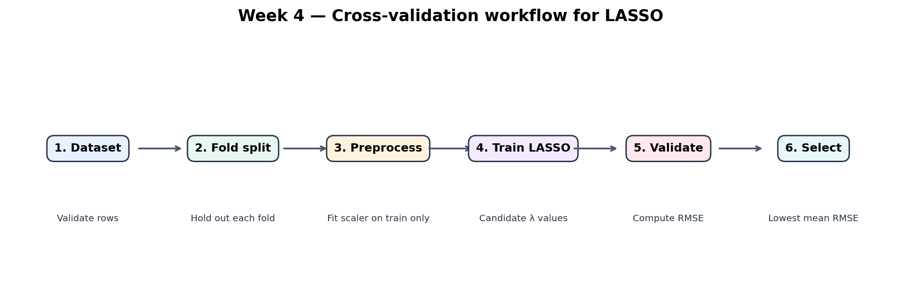

# Week 4 Technical Report: LASSO Validation and Model Improvement

## Abstract
Week 4 extends the Week 3 C++17 LASSO regression project with deterministic k-fold cross-validation for choosing the regularisation parameter λ. The extension compares candidate λ values by mean validation RMSE. It also reports fold-level scores and demonstrates a complete fit on a small illustrative energy dataset.

## 1. Problem statement
A model can appear accurate on training data while generalising poorly to unseen observations. Choosing λ by training cost alone may favour a model that does not predict well on new data. Week 4 introduces cross-validation as a more defensible model-selection method.

## 2. Objectives
- Implement reproducible k-fold cross-validation in C++17.
- Fit each fold's feature scaler using training rows only to prevent validation leakage.
- Compare candidate λ values using mean validation RMSE.
- Preserve the existing Week 2 and Week 3 code and tests.
- Document limitations and propose a responsible real-world use case.

## 3. Method
For each candidate λ, rows are shuffled with a fixed seed and assigned to k folds. Each fold is held out once. The scaler is fitted on the remaining training rows, then applied to both training and validation features. Coordinate descent fits the model on the training fold. Predictions for the held-out fold are evaluated using RMSE:

RMSE = sqrt((1/n) Σ(yᵢ − ŷᵢ)²)

The chosen parameter is the candidate with the lowest mean validation RMSE. The final demonstration then fits a model on all illustrative rows using that selected λ. The final printed MAE, RMSE and R² are training-fit diagnostics, not a substitute for a separate test set.

## 4. Workflow


1. Validate data dimensions.
2. Create deterministic folds.
3. Fit preprocessing on training folds only.
4. Train LASSO for each candidate λ.
5. Record each validation RMSE.
6. Select the λ with the lowest mean validation RMSE.

## 5. Implementation
New files:
- `include/lasso/week4.hpp` — cross-validation interface and result structure.
- `src/member10_cross_validation.cpp` — fold creation, leakage-aware scaling, evaluation and selection.
- `examples/week4_demo.cpp` — runnable energy-data demonstration.
- `tests/test_week4.cpp` — deterministic results, finite scores, selection and invalid-fold checks.

The implementation reuses the Week 3 `fit_scaler`, `coordinate_descent`, `predict_rows` and `evaluate_regression` functions. No third-party C++ library is required.

## 6. Illustrative results
Running `lasso_week4_demo` on the included synthetic educational dataset selects λ by 4-fold validation. Exact numeric output is generated by the program. The data are intentionally illustrative and are not measured vehicle telemetry, Tesla data, or a claim about a commercial system.

## 7. OOP and software design
The existing project uses a `LassoModel` class for the introductory one-feature baseline, and modular functions for preprocessing, fitting and evaluation. Week 4 retains the modular approach: `CrossValidationResult` groups related output values, while a small public API hides fold-management details from the demo. This is functional decomposition and data abstraction; it does not introduce inheritance or runtime polymorphism.

## 8. Real-world engineering relevance
For an electrical-engineering study, a future dataset might contain ambient temperature, route distance, payload, battery current, or energy consumption. Cross-validation can help assess whether a regression model generalises across observations. Any practical deployment would require authentic data, appropriate domain review, uncertainty analysis, privacy safeguards, and a separate untouched test set. The included dataset is synthetic and demonstrates method only.

Tesla's public AI and robotics work is a motivating technology context, not evidence that Tesla uses this student implementation. This project does not control a vehicle, robot, battery, or industrial process.

## 9. Limitations and next steps
- Small synthetic dataset: results are not statistically generalisable.
- The fixed seed improves reproducibility but does not remove sampling uncertainty.
- Fold assignment is shuffled but not stratified; ordinary regression usually does not require class stratification.
- The final demo reports training-fit diagnostics after selecting λ. A stronger experiment should reserve a final test set before tuning.
- Coordinate descent and scaling choices should be checked carefully for larger or highly collinear datasets.
- Future work: nested cross-validation, repeated cross-validation, residual plots, confidence intervals, and a real public dataset.

## 10. Build and run
```bash
cmake -S . -B build
cmake --build build
ctest --test-dir build --output-on-failure
./build/lasso_week4_demo
```
On Windows, run the executable as `build\lasso_week4_demo.exe` after building with CMake and a supported C++17 compiler.

## Conclusion
Week 4 adds a reproducible, leakage-aware cross-validation layer to the existing LASSO learning project. It improves the model-selection procedure without claiming that synthetic demonstration results represent real-world system performance.
