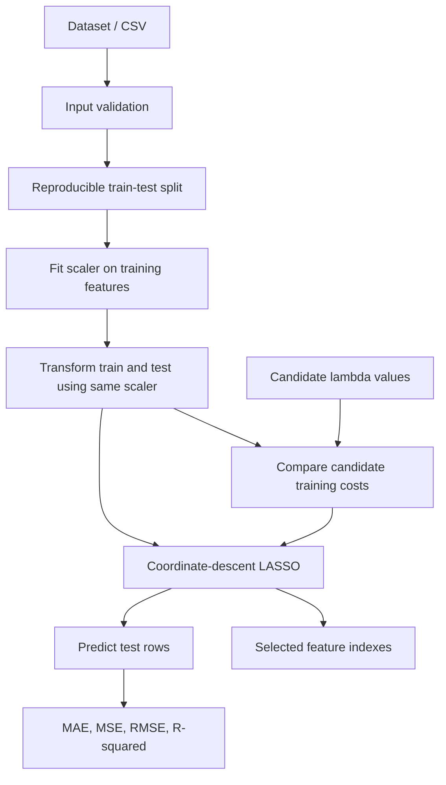
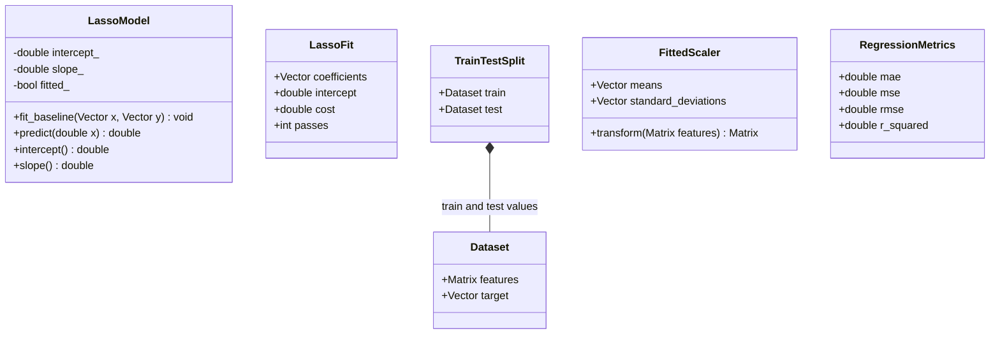
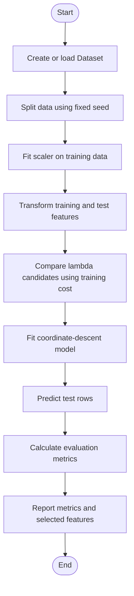
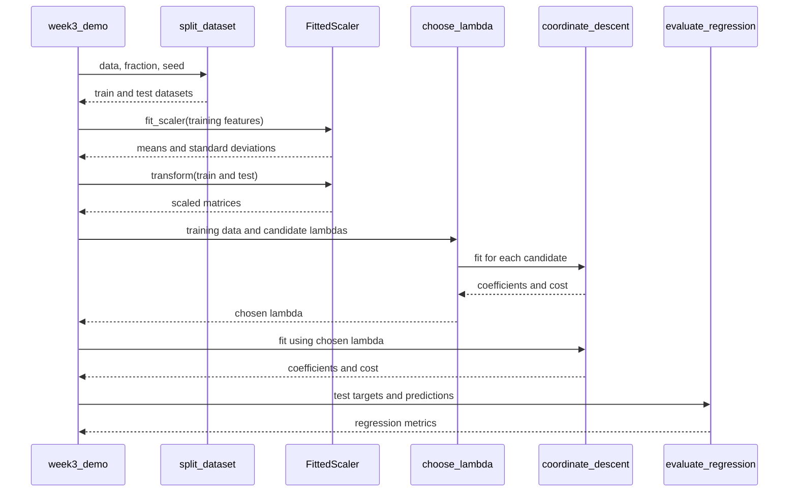

# LASSO Regression From Scratch in C++ — Week 3 Technical Report

**Student name:** [Insert name]  
**Student number:** [Insert number]  
**Course / unit:** [Insert course or unit]  
**Lecturer:** [Insert lecturer]  
**Institution:** [Insert institution]  
**Submission date:** [Insert date]

> **Academic integrity note:** Complete the placeholders and confirm that the implementation and explanations are understood by the submitting student or group. The report describes the files present in this archive; it does not claim unrecorded group contributions.

## Abstract

This project implements an educational LASSO regression workflow in C++17 without an external machine-learning library. It includes CSV loading, data validation, a reproducible train/test split, feature standardization, coordinate-descent coefficient fitting, soft-thresholding, predictions, feature selection, and regression metrics. The Week 3 workflow builds on Week 2 components and demonstrates how numerical processing stages can be composed into a repeatable experiment. The project compiles and the Week 2 and Week 3 test executables pass in the validation environment used for this review. The implementation remains instructional: the optimizer fits an unpenalized intercept, while the current lambda-selection helper compares penalized training costs rather than validation-set performance.

## 1. Introduction and background

Regression estimates a numerical target from one or more input features. LASSO (Least Absolute Shrinkage and Selection Operator) is a linear regression method that adds an L1 penalty to the squared-error objective. The penalty can shrink some coefficients to exactly zero, which can make the resulting model easier to interpret and can support feature selection [1].

This repository implements the calculations directly using standard C++ containers and functions. The main workflow is exposed through `include/lasso/week2.hpp` and `include/lasso/week3.hpp`; implementation is divided across `src/`, with examples in `examples/` and tests in `tests/`.

## 2. Problem statement

A beginner implementing regression needs to understand how data preparation, coefficient estimation, regularization, prediction, and evaluation fit together. Using a library would hide many of these operations. This project instead exposes the main numerical steps so they can be inspected and tested individually.

## 3. Aim and objectives

**Aim:** Implement and document a small LASSO regression workflow in C++17.

Objectives:
1. Represent feature data and target values using vectors and matrices.
2. validate row shapes and numeric inputs before processing;
3. split data reproducibly into training and test sets;
4. standardize features using statistics learned from training data only;
5. estimate coefficients using coordinate descent and soft-thresholding;
6. generate predictions, identify non-negligible coefficients, and calculate regression metrics;
7. build the library, examples, and tests using CMake.

## 4. Scope and limitations

The repository uses small, in-memory datasets and educational algorithms. It does not provide a production model-serving API, large-data optimization, cross-validation, automated missing-value imputation, or a full command-line interface. The CSV reader expects numeric rows in which the first column is the target and the remaining columns are features. The main Week 3 demonstration uses a small example dataset embedded in the source code.

The current `LassoModel` class fits a one-feature ordinary least-squares baseline; it is not the class used by the multi-feature LASSO coordinate-descent workflow. The name is retained to preserve the original project, but this distinction must be stated when presenting the code.

## 5. Requirements and implementation overview

### 5.1 Functional requirements

| Requirement | Implementation evidence |
|---|---|
| Read numeric CSV data | `load_csv()` in `src/lasso_regression.cpp` |
| Check input dimensions | `check_preprocessing_input()` and checks in numerical routines |
| Split data reproducibly | `split_dataset()` in `src/member01_data.cpp` |
| Check for NaN and infinity | `all_finite()` in `src/member02_preprocessing.cpp` |
| Standardize features | `standardize()` and `fit_scaler()` in `src/member03_scaling.cpp` |
| Calculate LASSO coefficients | `coordinate_descent()` in `src/member08_coordinate.cpp` |
| Apply L1 soft-thresholding | `soft_threshold()` in `src/lasso_regression.cpp` |
| Predict multiple rows | `predict_rows()` in `src/member04_matrix.cpp` |
| Select features by coefficient magnitude | `selected_features()` in `src/member07_soft_threshold.cpp` |
| Evaluate predictions | `evaluate_regression()` in `src/member09_evaluation.cpp` |
| Build and run tests | `CMakeLists.txt`, `tests/test_week2.cpp`, `tests/test_week3.cpp` |

### 5.2 Architecture

**Figure 1. System architecture and data flow.** Editable Mermaid source: [`docs/diagrams/system-architecture.mmd`](../docs/diagrams/system-architecture.mmd).



The scaler is fitted on the training feature matrix and then reused for the test matrix. This prevents the test feature distribution from influencing the scaling parameters. The current lambda helper, however, compares candidate penalized costs on the data passed to it; the demo passes training data. This is not the same as selecting lambda with a separate validation set or cross-validation.

## 6. Mathematical model

Let `X` be the feature matrix, `y` the target vector, `w` the coefficient vector, and `n` the number of rows. The implemented cost is:

\[
J(w)=\frac{1}{2n}\sum_{i=1}^{n}(x_i^T w-y_i)^2+\lambda\sum_{j=1}^{p}|w_j|.
\]

The first term penalizes prediction error. The second term is the L1 penalty; `lambda` controls its strength. A larger value generally encourages more coefficients to become zero, although the result depends on the data. This objective matches the standard LASSO formulation documented by scikit-learn [1].

The coordinate-descent implementation updates one coefficient at a time while holding the other current coefficients fixed. It also updates an unpenalized intercept from the mean residual, so the fitted prediction is `intercept + dot(features, coefficients)`. The L1 penalty applies to the feature coefficients, not the intercept. The soft-threshold function returns zero when a value lies between `-threshold` and `threshold`; otherwise it subtracts the threshold magnitude while retaining the sign. The project uses this operation to implement the L1 penalty.

## 7. Class and object analysis

### 7.1 Class and structure inventory

| Type | Kind | Responsibility and important members | Relationships |
|---|---|---|---|
| `LassoModel` | `class` | Stores `intercept_`, `slope_`, `fitted_` privately; exposes `fit_baseline`, `predict`, `intercept`, and `slope` publicly | No inheritance; represents a fitted one-feature baseline line |
| `Dataset` | `struct` | Holds `features` and `target` | Used by the split workflow and CSV loader |
| `BaselineResult` | `struct` | Holds baseline intercept, slope, and MSE | Returned by `linear_regression_baseline()` |
| `ScaledData` | `struct` | Holds standardized features and their means and standard deviations | Returned by the Week 2 `standardize()` function |
| `LassoFit` | `struct` | Holds coefficients, fitted intercept, cost, and number of passes | Returned by `coordinate_descent()` |
| `TrainTestSplit` | `struct` | Holds `train` and `test` `Dataset` values | Contains two datasets by value (composition-like containment) |
| `FittedScaler` | `struct` | Stores means and standard deviations and provides `transform()` | One scaler object can transform training and test matrices |
| `RegressionMetrics` | `struct` | Holds MAE, MSE, RMSE, and R-squared | Returned by `evaluate_regression()` |

### 7.2 UML class diagram

**Figure 2. Main class and data-structure diagram.** Editable source: [`docs/diagrams/class-diagram.mmd`](../docs/diagrams/class-diagram.mmd).



UML visibility symbols are `+` for public and `-` for private. The data structures use `struct`, so their members are public by default. The `LassoModel` members are private and can only be accessed through its public interface. `TrainTestSplit` contains two `Dataset` values; this is a value-containment relationship, not a pointer-based shared-lifetime relationship.

### 7.3 Class versus object

A **class** defines a type and its operations; an **object** is a concrete instance of that type. For example, `FittedScaler` is the type definition. In the demo, `const auto scaler = lasso::fit_scaler(split.train.features);` creates a scaler object containing means and standard deviations computed from that training dataset. Another dataset could be processed by another scaler object with different stored values.

## 8. Main workflow and object interactions

**Figure 3. Program flow.** Editable source: [`docs/diagrams/main-flow.mmd`](../docs/diagrams/main-flow.mmd).



**Figure 4. Sequence of major calls.** Editable source: [`docs/diagrams/sequence-diagram.mmd`](../docs/diagrams/sequence-diagram.mmd).



**Figure 5. Input-process-output view.** Editable source: [`docs/diagrams/input-process-output.mmd`](../docs/diagrams/input-process-output.mmd).

- **Input:** numeric feature matrix, target values, and candidate lambda values.
- **Process:** split, standardize, fit coefficients, predict, and evaluate.
- **Output:** fitted coefficients, selected feature indexes, predictions, and evaluation metrics.

## 9. The four OOP pillars in the actual project

### 9.1 Encapsulation — implemented in `LassoModel`

`LassoModel` combines state and operations. The data members `intercept_`, `slope_`, and `fitted_` are private. Calling code cannot assign them directly; it uses `fit_baseline()`, `predict()`, `intercept()`, and `slope()`. The `const` qualifiers on the read-only member functions communicate that these calls do not modify the object. This is a real example of encapsulation in the current code.

The other result types are `struct`s and expose their members publicly. They are simple data-transfer structures, not examples of strong data hiding.

### 9.2 Abstraction — present at function and interface level

Functions such as `coordinate_descent()`, `fit_scaler()`, `predict_rows()`, and `evaluate_regression()` expose named operations while hiding their loops and calculations behind a function call. `FittedScaler::transform()` also provides a small interface for applying saved scaling parameters. This is functional abstraction, but the project does not define an abstract base class or a formal model interface.

### 9.3 Inheritance — not implemented

No project class derives from another project class. The code should not show an inheritance arrow or claim that a parent-child class hierarchy exists. Inheritance is not required for the current numerical workflow. If future requirements call for interchangeable regression algorithms, a small abstract `RegressionModel` interface could be considered, but it should only be added if at least two concrete models genuinely use it.

### 9.4 Polymorphism — not implemented

There are no virtual functions, overrides, or calls through base-class pointers/references in the current project. Calls to `coordinate_descent()` and `evaluate_regression()` select named functions directly. The project also does not intentionally demonstrate function overloading or operator overloading. Do not label these direct calls as polymorphism.

| Pillar | Actual status | Evidence or gap |
|---|---|---|
| Encapsulation | Implemented | Private `LassoModel` state and public methods |
| Abstraction | Present in a limited, functional form | Numerical operations are exposed through functions and `FittedScaler::transform()` |
| Inheritance | Not implemented | No derived classes |
| Polymorphism | Not implemented | No virtual functions, overrides, or overload demonstrations |

The project is primarily a numerical-programming assignment. Adding inheritance purely to tick a box would risk making the design less natural. If the course rubric explicitly requires all four pillars to be demonstrated in code, confirm that requirement before adding a model hierarchy; the current source does not satisfy that stronger requirement.

## 10. Evaluation metrics

The evaluation routine calculates:

- **Mean Absolute Error (MAE):** average absolute difference between actual and predicted targets.
- **Mean Squared Error (MSE):** average squared difference; larger errors have a greater influence.
- **Root Mean Squared Error (RMSE):** square root of MSE, expressed in the target's units.
- **R-squared:** compares residual squared error with the total variation in the actual targets. In this implementation, R-squared is set to zero when the actual targets have zero total variation; that convention should be kept in mind when interpreting constant-target data.

Metrics should be calculated on held-out data to estimate generalization. The demo follows that pattern by predicting the test feature rows and evaluating against the test target values.

## 11. Testing methodology and verified results

The review environment used GNU C++ 14.2.0 and CMake. The project requests C++17 and enables `-Wall -Wextra -Wpedantic` for the library. The following actions were actually performed after the project changes:

| Check | Result |
|---|---|
| CMake configuration | Passed |
| Compilation of library, demo, and both test executables | Passed |
| Week 2 test executable via CTest | Passed |
| Week 3 test executable via CTest | Passed |
| Manual review of lambda and feature-selection validation paths | Added checks; automated rejection tests included |

The automated test programs use `assert()` to check expected values, intercept-aware prediction, and rejection of malformed inputs. They cover standardization, coordinate-descent output, train/test sizes, scaling transformation, prediction, feature selection, evaluation metrics, and invalid lambda/threshold inputs. Tests do not establish model quality on real-world datasets, and no external dataset benchmark or cross-validation experiment was performed.

Reproduce the checks from the project root:

```bash
cmake -S . -B build
cmake --build build
ctest --test-dir build --output-on-failure
./build/lasso_week3_demo
```

A CTest test passes when its command exits successfully; this project registers the two test executables through CMake/CTest [2]. The demo output observed in this review was:

```text
train rows: 6
test rows: 2
lambda: 0.010
test MAE: 1.041
test RMSE: 1.045
selected features: 2
```

These values describe only the small bundled example and are not evidence of performance on a representative real-world dataset.

## 12. Relevant technological development

LASSO remains a useful method for sparse linear models: the L1 penalty can set coefficients to zero, and the regularization parameter controls the strength of that penalty [1]. Production libraries also offer model-selection tools such as LASSO cross-validation, which estimates performance across folds rather than choosing a penalty solely from training cost [3].

A proportionate next improvement for this project is to add a validation or cross-validation procedure for lambda selection. The benefit is a more defensible choice of regularization strength. The trade-offs are more implementation complexity and additional computation, particularly for small datasets. Any such addition must keep the test set separate from parameter selection.

A further improvement is to test intercept estimation on synthetic datasets with known offsets and on larger datasets. The current optimizer now estimates the intercept explicitly and excludes it from the L1 penalty; the existing example is small, so broader numerical testing remains useful.

## 13. Discussion, limitations, and recommendations

The repository is modular enough for a student to follow: header files declare the public API, source files implement individual tasks, and tests exercise selected behaviour. The train-only scaler is a sound design decision because it avoids using test-set statistics during preprocessing. The seeded split also makes the split reproducible for the same standard-library implementation and input ordering.

Main limitations:
1. `choose_lambda()` compares penalized costs on the dataset passed to it; it is not validation or cross-validation model selection.
2. The data examples are small and do not establish real-world predictive performance.
3. `LassoModel` is a baseline linear model despite its name, while the actual multi-feature LASSO fitting uses free functions and `LassoFit`.
4. Inheritance and polymorphism are not implemented; abstraction is mostly through functions and a small scaler interface.
5. CSV parsing is intentionally simple and expects numeric cells with the target in the first column.

Recommended priorities are: (1) add stronger malformed CSV and non-finite input tests; (2) separate validation data from test data for lambda selection; (3) expand intercept and numerical edge-case tests; and (4) only introduce a polymorphic model interface if the assignment explicitly requires it or multiple interchangeable model types are planned.

## 14. Conclusion

The project provides a compact C++17 demonstration of LASSO-related numerical operations and a repeatable Week 3 workflow. The code builds successfully and both registered test suites pass in the review environment. Its strongest OOP evidence is encapsulation in `LassoModel` and function-level abstraction in the numerical API. Inheritance and polymorphism are absent and are reported honestly. Further work should focus first on statistically sound lambda selection and more comprehensive numerical validation rather than adding unnecessary object-oriented complexity.

## References

[1] scikit-learn developers, “Lasso,” *scikit-learn API documentation*. Available: https://scikit-learn.org/stable/modules/generated/sklearn.linear_model.Lasso.html. Accessed: 22 Oct. 2026.

[2] Kitware, Inc., “add_test — CMake Documentation.” Available: https://cmake.org/cmake/help/latest/command/add_test.html. Accessed: 22 Oct. 2026.

[3] scikit-learn developers, “Lasso model selection: Cross-validation and information criteria,” *scikit-learn User Guide*. Available: https://scikit-learn.org/stable/modules/linear_model.html#lasso. Accessed: 22 Oct. 2026.

## Appendix A — Project file map

- `include/lasso/lasso_regression.hpp`: shared types, `LassoModel`, baseline regression, cost, vector/matrix helpers, CSV loader.
- `include/lasso/week2.hpp`: Week 2 preprocessing, standardization, coordinate descent, and MAE declarations.
- `include/lasso/week3.hpp`: train/test split, fitted scaler, prediction, feature selection, and metric declarations.
- `src/`: implementation files.
- `examples/`: Week 2/Week 3 demonstrations and focused examples.
- `tests/`: Week 2 and Week 3 assertion-based test programs.
- `docs/diagrams/`: editable Mermaid diagram sources.
- `reports/individual/`: individual report templates that must be completed with real contribution details.

## 14. Colour illustrations and visual interpretation

The following original colour figures are included in `docs/figures/` and are embedded in the accompanying PDF appendix. They are explanatory illustrations, not measured results from the repository's training or test dataset.

**Figure 6. Illustrative regression fit.** `docs/figures/lasso_fit_illustration.png` shows synthetic observations and a fitted straight line to explain the relationship between input features and a numerical target. The points are generated for teaching and are not project evaluation results.

**Figure 7. Conceptual coefficient shrinkage.** `docs/figures/lasso_coefficient_shrinkage.png` illustrates the general effect of increasing the L1 regularization strength. The curves are conceptual and do not represent coefficients fitted by this repository.

**Figure 8. Colour-coded workflow.** `docs/figures/lasso_workflow_colored.png` summarizes the stages from data input through validation, scaling, fitting, prediction, and evaluation. The scaling step should be fitted on training data and reused for test data.

**Figure 9. Simplified project relationships.** `docs/figures/project_relationships_colored.png` provides a visual overview of selected data structures. It is a teaching summary rather than a complete UML diagram; the editable UML source remains in `docs/diagrams/class-diagram.mmd`.

These figures were created specifically for this report. No external photographs are used, so no stock-image attribution is required. The technical claims about LASSO remain supported by the references listed in the report.
