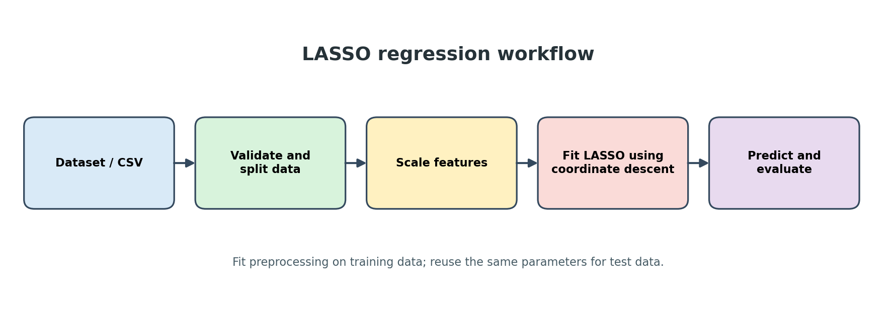
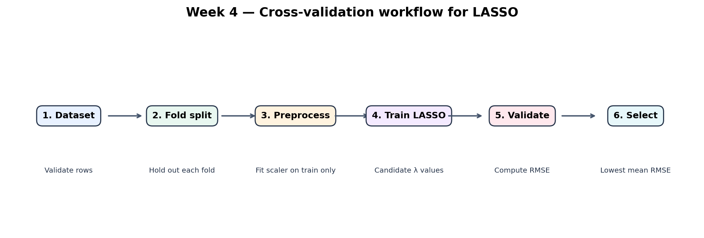
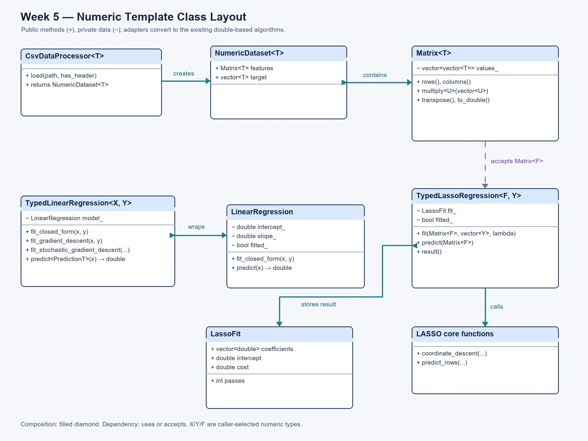

# Group 14: LASSO Regression in C++ — Week 5 Final

## Project Overview

In this project, we developed a C++17 library to demonstrate how Linear Regression and LASSO Regression work. We started with the basic one-feature linear regression model in Week 2 and gradually improved the project in the following weeks.

In Week 3, we worked on LASSO regression, which allows us to work with multiple input features and select the most useful ones. In Week 4, we added cross-validation to help us compare different lambda values and choose a suitable one. In Week 5, we introduced C++ templates so that our programs could work with different numeric data types.

By the end of the project, we had combined the different weekly tasks into one library, added demonstrations and tests, and prepared the documentation for our final submission.

## Objectives

The main objectives we aimed to achieve were:

- To develop a reusable C++ library with header files separated from implementation files.
- To read and check data from CSV files.
- To understand and implement standardization, soft-thresholding, and LASSO coordinate descent.
- To compare different lambda values using k-fold cross-validation.
- To ensure that data preprocessing is done using training data to avoid data leakage.
- To demonstrate object-oriented programming through a simple regression class.
- To test our programs using both valid and invalid inputs.

## Main Features

Our project includes the following features:

- **Linear Regression:** We implemented `linreg::LinearRegression`, which can fit a simple regression model using least squares, batch gradient descent, or stochastic gradient descent.
- **CSV Data Loading:** We added `lasso::load_csv` to read numerical data from CSV files. The first column contains the target values, while the remaining columns contain the input features.
- **Data Standardization:** We implemented `lasso::standardize` and `lasso::FittedScaler` to scale data using its mean and standard deviation.
- **LASSO Regression:** We used `lasso::coordinate_descent` to train the LASSO model and calculate its coefficients and intercept.
- **Cross-Validation:** We added `lasso::cross_validate_lambda` and `lasso::select_lambda_by_cross_validation` to compare different lambda values using validation RMSE.
- **Model Evaluation:** We included MAE, MSE, RMSE, and R-squared to help us measure how well our models perform.
- **C++ Templates:** In Week 5, we introduced `numerics::Matrix<T>`, `NumericDataset<T>`, and `CsvDataProcessor<T>` to support common numeric data types such as `short`, `int`, `float`, and `double`.
- **Typed Regression Models:** We added `TypedLinearRegression<InputT, TargetT>` and `TypedLassoRegression<FeatureT, TargetT>` to allow different numeric input and target types to work with our existing regression algorithms.
- **Build and Testing:** We used CMake to build the libraries and demonstration programs. We also included five CTest test programs to check that the main features work correctly.

All the sample data used in this project is artificially generated for learning and testing. It does not represent actual Tesla measurements or data from any real vehicle, building, or energy system.

## Illustrations

We included coloured diagrams and illustrations to make it easier to understand how the different parts of our project work.

The illustrations show the LASSO workflow, how coefficients are reduced during regularization, and how cross-validation is used to compare models.

We also included a conceptual illustration showing some possible applications of the technology. These applications are examples only; they are not systems that we developed in this project.

The Week 3 class diagrams and Week 5 template UML diagram are also available as JPG images in the `docs/figures/` folder.

## Requirements

To build and run our project, we need:

- A C++17 compiler such as GCC, Clang, or MSVC.
- CMake version 3.16 or later.
- No additional third-party libraries are required.

## Building, Testing and Installing the Project

To build and test our project, open a terminal in the